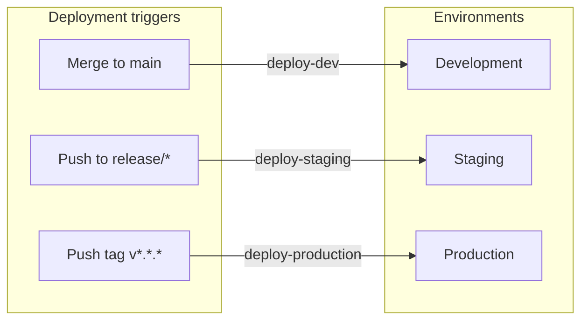
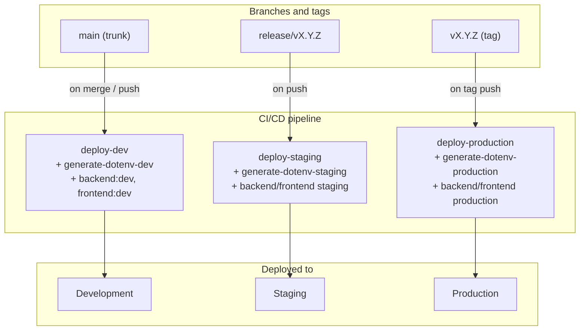
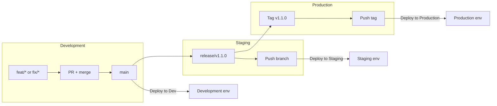

# Git Flow & Deployment Guide

This document outlines the **Trunk-Based Development** workflow and the automated deployment process for our monorepo.

## 1. Core Principles

Our workflow is based on a **Scaled Trunk-Based Development** model. The `main` branch is the heart of the project.

- **Feature Branches:** Used for all new development and bug fixes.
- **Continuous Integration:** Every PR triggers a full suite of automated tests and linters to ensure the monolith remains stable.
- **Trunk Stability:** `main` must always be in a deployable state.

---

## 2. Branching Strategy

| Branch Type    | Naming Convention                      | Base Branch | Target Branch |
| :------------- | :------------------------------------- | :---------- | :------------ |
| **Trunk**      | `main`                                 | -           | -             |
| **Feature/Fix** | `feat/JIRA-123-desc` or `fix/...`     | `main`      | `main`        |
| **Release**    | `release/vX.Y.Z`                       | `main`      | -             |

---

## 3. Development Lifecycle

### Step 1: Feature Development

Developers work on isolated feature branches. There is no strict time limit; the branch lives as long as the task requires.

```bash
git checkout main
git pull origin main
git checkout -b feat/your-feature-name
```

### Step 2: Automated Testing (Full CI)

Since our architecture is monolithic, every push to a feature branch triggers a **full CI pipeline**. This ensures that changes in one part of the system don't accidentally break another.

- **Linting & Formatting**
- **Unit & Integration Tests**
- **Build Verification**

### Step 3: Pull Request & Merge

Once the task is complete:

1. Open a PR to `main`.
2. Pass the mandatory code review.
3. Merge the PR.

> **Dev Deployment:** Merging to `main` automatically triggers a deployment to the **Development** environment.

---

## 4. Promotion to Staging & Production

We use a **"Promote-by-Push"** strategy to move code through the pipeline.

### Staging (Release Branches)

When a set of features in `main` is ready for QA/Staging:

1. Create a release branch:
   ```bash
   git checkout -b release/v1.1.0
   ```
2. Push it to the remote repository.

> **Staging Deployment:** Any push to a `release/*` branch automatically deploys to the **Staging** environment.

### Production (Git Tags)

When the code on Staging is verified and ready for real users:

1. Create a version tag from the release branch:
   ```bash
   git tag -a v1.1.0 -m "Product Release 1.1.0"
   ```
2. Push the tag to origin:
   ```bash
   git push origin v1.1.0
   ```

> **Production Deployment:** Pushing a tag triggers the final **Production** deployment.

---

## 5. Summary Table: Deployment Triggers

| Action             | Environment     | Trigger Type            |
| :----------------- | :-------------- | :---------------------- |
| Merge to `main`    | **Development** | Automatic on Merge      |
| Push to `release/*`| **Staging**     | Automatic on Push       |
| Create Tag `v*.*.*`| **Production**  | Automatic on Tag Push   |

---

## 6. Deployment Logic: Branches/Tags → Environments (Mermaid)



**Branch/tag → environment mapping:**



**End-to-end flow (feature → production):**


