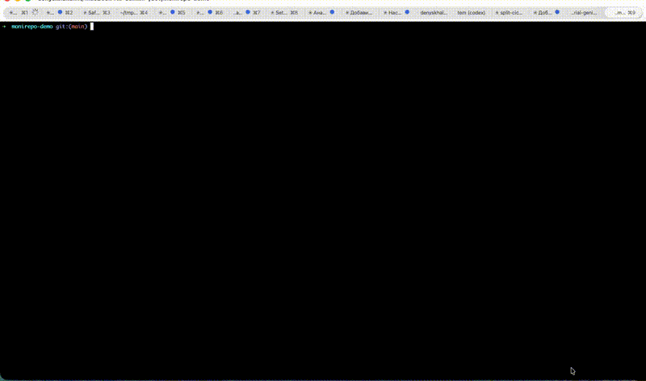

# Monorepo

Frontend (React/Vite), backend (NestJS/Lambda), and infrastructure (Terragrunt/AWS) in one repo.

## Demo

End-to-end run — from `make` (bootstrap) through the CI/CD pipeline:



## Bootstrap

First-time setup that provisions AWS resources, generates GitHub Actions secrets, and configures local tooling:

```bash
make
```

This runs the interactive bootstrap script which will:

1. Prompt for project name (`application_id`), AWS profile, and region
2. Validate AWS access
3. Create an S3 bucket for Terraform state
4. Create an EC2 key pair (ed25519)
5. Create an IAM user with static credentials for CI
6. Upload Actions secrets to GitHub (via the authenticated `gh` CLI)
7. Generate `iaac/mise.toml` for local infrastructure work
8. Reset Git history to a single initial commit on `main` — the old `.git` is backed up to `.git-history-backup-<timestamp>/`, and the template repo itself is never rewritten (skip with `--keep-history`)

**Prerequisites:** `aws` (configured), `jq`, `curl`, `git`, `gh` (authenticated), `ssh-keygen`

**Full procedure:** [docs/BOOTSTRAP.md](iaac/docs/BOOTSTRAP.md) — from repo download through Git init, `make`, `gh auth login`, and the modules-repo deploy key.

## Documentation

**Start here:** [SETUP.md](SETUP.md) — full setup, GitHub Actions secrets, pipeline flow, and local development.

| Part | Path | Purpose                                                              |
|------|------|----------------------------------------------------------------------|
| **Frontend** | [frontend/](frontend/) | SPA; deploys to S3/CloudFront                                        |
| **Backend** | [backend/](backend/) | API and Lambdas; see [backend/README.md](backend/README.md)          |
| **Infrastructure** | [iaac/](iaac/) | Terragrunt/Terraform; see [iaac/docs/README.md](iaac/docs/README.md) |
| **CI/CD** | [.github/workflows/](.github/workflows/) | GitHub Actions workflows (validate, deploy, pr-environment, renovate) |
